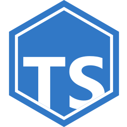

<div align="center">
  

# kirby-types

A collection of TypeScript types for [Kirby CMS](https://getkirby.com).

[Installation](#installation) •
[Quick Start](#quick-start) •
[Use Cases](#use-cases) •
[API](#api)

</div>

## When to Use

| Use Case                                                     | Types to Import                              |
| ------------------------------------------------------------ | -------------------------------------------- |
| **Typing blocks and layouts** in fetched content             | `KirbyBlock`, `KirbyLayout`                  |
| **Building KQL queries** with type safety                    | `KirbyQueryRequest`, `KirbyQueryResponse`    |
| **Developing Panel plugins** (Vue components, custom fields) | `Panel`, `PanelApi`                          |
| **Creating Writer extensions** (rich text editor)            | `WriterMarkExtension`, `WriterNodeExtension` |

## Installation

```bash
# pnpm
pnpm add -D kirby-types@next

# npm
npm i -D kirby-types@next

# yarn
yarn add -D kirby-types@next
```

| kirby-types | Kirby   | Panel   |
| ----------- | ------- | ------- |
| v2          | 6       | Vue 3   |
| v1          | 4 and 5 | Vue 2.7 |

Until Kirby 6 has a stable release, v2 is published under the `next` tag, and a bare `kirby-types` installs v1.

### Optional Dependencies

`vue`, `dayjs`, and six `prosemirror-*` packages are optional peer dependencies. With `skipLibCheck: true`, install only the peers behind the types you use – none for the content and KQL types. With `skipLibCheck: false`, TypeScript reports each missing peer as a module it cannot find, so install all eight.

`vue` is the peer every Panel plugin needs:

```bash
pnpm add -D vue@^3.5.0
```

`dayjs` powers the [`$library.dayjs` types](./src/panel/libraries.d.ts), including Kirby's plugin extensions (`toISO`, `parse`, `pattern`, …):

```bash
pnpm add -D dayjs
```

The `prosemirror-*` packages type the Writer extensions:

```bash
pnpm add -D prosemirror-commands prosemirror-inputrules prosemirror-model prosemirror-schema-list prosemirror-state prosemirror-view
```

## Quick Start

`KirbyQueryRequest` checks a KQL request as you write it. `KirbyQueryResponse<T>` is the response, with `T` as its `result`:

```ts
import type { KirbyQueryRequest, KirbyQueryResponse } from "kirby-types";

const request: KirbyQueryRequest = {
  query: "site",
  select: {
    title: true,
    children: {
      query: "site.children",
      select: ["id", "title", "isListed"],
    },
  },
};

interface SiteData {
  title: string;
  children: { id: string; title: string; isListed: boolean }[];
}

type SiteResponse = KirbyQueryResponse<SiteData>;
```

## Use Cases

### Type a Paginated KQL Response

```ts
import type { KirbyQueryRequest, KirbyQueryResponse } from "kirby-types";

const request: KirbyQueryRequest = {
  query: 'page("blog").children.listed',
  select: {
    title: "page.title",
    date: "page.date.toDate",
    excerpt: "page.text.toBlocks.excerpt(200)",
  },
  pagination: { limit: 10, page: 1 },
};

interface BlogPostSummary {
  title: string;
  date: string;
  excerpt: string;
}

// With pagination: `true` as the second type argument
type PaginatedResponse = KirbyQueryResponse<BlogPostSummary[], true>;

// Response shape:
// {
//   code: 200,
//   status: "ok",
//   result: {
//     data: BlogPostSummary[],
//     pagination: { page, pages, offset, limit, total }
//   }
// }
```

### Type a Block With Content

```ts
import type { KirbyBlock } from "kirby-types";

// Default block types are fully typed
const textBlock: KirbyBlock<"text"> = {
  id: "abc123",
  type: "text",
  isHidden: false,
  content: { text: "<p>Hello world</p>" },
};

// Custom blocks with your own content structure
interface HeroContent {
  title: string;
  image: string;
  cta: string;
}

const heroBlock: KirbyBlock<"hero", HeroContent> = {
  id: "def456",
  type: "hero",
  isHidden: false,
  content: {
    title: "Welcome",
    image: "hero.jpg",
    cta: "Learn more",
  },
};
```

### Type a Layout

```ts
import type { KirbyLayout } from "kirby-types";

const layout: KirbyLayout = {
  id: "layout-1",
  attrs: { class: "highlight" },
  columns: [
    { id: "col-1", width: "1/3", blocks: [] },
    { id: "col-2", width: "2/3", blocks: [] },
  ],
};
```

### Type Page Content With Blocks and Layouts

`PanelModelData` wraps the content in the page data the Panel API returns, e.g. from `window.panel.api.pages.get()`:

```ts
import type { KirbyBlock, KirbyLayout, PanelModelData } from "kirby-types";

// Define custom block types alongside defaults
interface CallToActionContent {
  text: string;
  url: string;
  style: "primary" | "secondary";
}

type CustomBlock =
  | KirbyBlock<"text">
  | KirbyBlock<"heading">
  | KirbyBlock<"image">
  | KirbyBlock<"cta", CallToActionContent>;

interface BlogPostContent {
  date: string;
  author: string;
  blocks: CustomBlock[];
  layout: KirbyLayout[];
}

type BlogPostPage = PanelModelData<BlogPostContent>;
```

### Type a Panel Plugin

Import the opt-in globals once, e.g. in your plugin's entry file. The import adds types for `window.panel` and for the Panel's global properties on every Vue component (`this.$panel`, `this.$t`, `this.$helper`, …):

```ts
import "kirby-types/panel-globals";

window.panel.plugin("my/plugin", {
  fields: {
    color: {
      extends: "k-text-field",
    },
  },
  created(instance) {
    instance.$panel.notification.info("Plugin ready");
  },
});
```

Every `window.panel` member is verified against the PHP response shape (`toArray()`/`props()`) and the Panel source, and follows PHP where the two disagree.

Common Panel operations:

```ts
// Notifications
window.panel.notification.success("Changes saved");
window.panel.notification.error("Something went wrong");

// Theme
window.panel.theme.set("dark");

// Navigation
await window.panel.view.open("/pages/blog");
await window.panel.dialog.open("pages/create");

// API calls
const page = await window.panel.api.pages.get("blog");
await window.panel.api.pages.update("blog", { title: "New Title" });

// Content state
const currentContent = window.panel.content.version("changes");
```

### Type a Writer Extension

Install the `prosemirror-*` [peer dependencies](#optional-dependencies) to type a Writer extension:

```ts
import type { WriterMarkExtension } from "kirby-types";
import "kirby-types/panel-globals";

const highlight: WriterMarkExtension = {
  button: {
    icon: "highlight",
    label: "Highlight",
  },
  commands({ type, utils }) {
    return () => utils.toggleMark(type);
  },
  inputRules({ type, utils }) {
    return [utils.markInputRule(/\*\*([^*]+)\*\*$/, type)];
  },
  schema: {
    parseDOM: [{ tag: "mark" }],
    toDOM: () => ["mark", 0],
  },
};

window.panel.plugin("my/plugin", {
  writerMarks: { highlight },
});
```

## API

### Content Types

| Type                                          | Description                                 |
| --------------------------------------------- | ------------------------------------------- |
| [`KirbyApiResponse<T>`](./src/api.d.ts)       | KQL and error response envelope             |
| [`KirbyBlock<T, U>`](./src/blocks.d.ts)       | Block with type and content                 |
| [`KirbyLayout`](./src/layout.d.ts)            | Layout row with columns                     |
| [`KirbyLayoutColumn`](./src/layout.d.ts)      | Column with width and blocks                |
| [`KirbyLayoutColumnWidth`](./src/layout.d.ts) | Column width as a fraction, such as `"1/2"` |
| [`KirbyDefaultBlock`](./src/blocks.d.ts)      | Union of default blocks by type             |
| [`KirbyDefaultBlocks`](./src/blocks.d.ts)     | Map of default block content types          |
| [`KirbyDefaultBlockType`](./src/blocks.d.ts)  | Union of default block type names           |
| [`KirbyCodeLanguage`](./src/blocks.d.ts)      | Languages the code block offers             |

### KQL Types

| Type                                         | Description                                                               |
| -------------------------------------------- | ------------------------------------------------------------------------- |
| [`KirbyQueryRequest`](./src/kql.d.ts)        | KQL request with pagination or named queries                              |
| [`KirbyQueryResponse<T, P>`](./src/kql.d.ts) | KQL response with optional pagination                                     |
| [`KirbyQuerySchema`](./src/kql.d.ts)         | `query` and `select` of a KQL request                                     |
| [`KirbyQuery<M>`](./src/query.d.ts)          | Valid Kirby query string                                                  |
| [`KirbyQueryRoot<M>`](./src/query.d.ts)      | Root a query starts from, such as `site` or `page`; `M` adds custom roots |
| [`KirbyQueryChain<M>`](./src/query.d.ts)     | Query that continues after its root, such as `page.children.listed`       |
| [`ParseKirbyQuery<T, M>`](./src/query.d.ts)  | Query string parsed into its root and chain                               |

### Panel Types

| Type                                                  | Description                                                             |
| ----------------------------------------------------- | ----------------------------------------------------------------------- |
| [`Panel`](./src/panel/index.d.ts)                     | The `window.panel` object                                               |
| [`PanelApi`](./src/panel/api.d.ts)                    | The `window.panel.api` client                                           |
| [`PanelState`](./src/panel/base.d.ts)                 | Reactive base of every Panel state                                      |
| [`PanelFeature`](./src/panel/base.d.ts)               | Feature with loading states                                             |
| [`PanelModal`](./src/panel/base.d.ts)                 | Modal (dialog/drawer) interface                                         |
| [`PanelHelpers`](./src/panel/helpers.d.ts)            | The `$helper` functions                                                 |
| [`PanelGlobalProperties`](./src/panel/index.d.ts)     | Global properties on every Vue component (`$panel`, `$t`, `$helper`, …) |
| [`PanelPluginExtensions`](./src/panel/index.d.ts)     | Extensions a plugin registers with `window.panel.plugin()`              |
| [`PanelModelData<T>`](./src/panel/api.d.ts)           | Page, file, user, or site data the Panel API returns                    |
| [`PanelLanguageInfo`](./src/panel/index.d.ts)         | Language of a multi-language site, as in `window.panel.languages`       |
| [`PanelViewProps`](./src/panel/index.d.ts)            | Props of a page or site view                                            |
| [`PanelFileViewProps`](./src/panel/index.d.ts)        | Props of a file view                                                    |
| [`PanelUserViewProps`](./src/panel/index.d.ts)        | Props of a user view and the account view                               |
| [`TextareaButton`](./src/panel/textarea.d.ts)         | Custom textarea toolbar button                                          |
| [`TextareaToolbarContext`](./src/panel/textarea.d.ts) | `this` in a textarea button's click handler                             |

### Blueprint Types

| Type                                               | Description                              |
| -------------------------------------------------- | ---------------------------------------- |
| [`KirbyFieldProps`](./src/blueprint.d.ts)          | Base field props from `Field->toArray()` |
| [`KirbyInputFieldProps`](./src/blueprint.d.ts)     | Base props of an input field             |
| [`KirbyFieldsetProps`](./src/blueprint.d.ts)       | Fieldset from `Fieldset->toArray()`      |
| [`KirbyBlocksFieldProps`](./src/blueprint.d.ts)    | Blocks field props with fieldsets        |
| [`KirbyStructureFieldProps`](./src/blueprint.d.ts) | Structure field props with nested fields |
| [`KirbyLayoutFieldProps`](./src/blueprint.d.ts)    | Layout field props with settings         |
| [`KirbyAnyFieldProps`](./src/blueprint.d.ts)       | Union of all field prop types            |

<details>
<summary>View the remaining field prop types</summary>

| Type                                               | Description                      |
| -------------------------------------------------- | -------------------------------- |
| [`KirbyTextFieldProps`](./src/blueprint.d.ts)      | Text field props                 |
| [`KirbyTextareaFieldProps`](./src/blueprint.d.ts)  | Textarea field props             |
| [`KirbyNumberFieldProps`](./src/blueprint.d.ts)    | Number field props               |
| [`KirbyDateFieldProps`](./src/blueprint.d.ts)      | Date and time field props        |
| [`KirbyPickerFieldProps`](./src/blueprint.d.ts)    | Files/pages/users picker props   |
| [`KirbyModelListFieldProps`](./src/blueprint.d.ts) | File and page list field props   |
| [`KirbyOptionsFieldProps`](./src/blueprint.d.ts)   | Select/radio/checkboxes/toggles  |
| [`KirbyToggleFieldProps`](./src/blueprint.d.ts)    | Toggle (boolean) field props     |
| [`KirbyColorFieldProps`](./src/blueprint.d.ts)     | Color picker field props         |
| [`KirbyRangeFieldProps`](./src/blueprint.d.ts)     | Range slider field props         |
| [`KirbyTagsFieldProps`](./src/blueprint.d.ts)      | Tags and multiselect field props |
| [`KirbyLinkFieldProps`](./src/blueprint.d.ts)      | Link field props                 |
| [`KirbyObjectFieldProps`](./src/blueprint.d.ts)    | Object field props               |
| [`KirbyWriterFieldProps`](./src/blueprint.d.ts)    | Writer (rich text) field props   |
| [`KirbyListFieldProps`](./src/blueprint.d.ts)      | List field props                 |
| [`KirbyEntriesFieldProps`](./src/blueprint.d.ts)   | Entries field props              |
| [`KirbyStatsFieldProps`](./src/blueprint.d.ts)     | Stats field props                |

</details>

### Writer Types

| Type                                             | Description                                 |
| ------------------------------------------------ | ------------------------------------------- |
| [`WriterEditor`](./src/panel/writer.d.ts)        | Main editor instance                        |
| [`WriterMarkExtension`](./src/panel/writer.d.ts) | Custom mark, registered under `writerMarks` |
| [`WriterNodeExtension`](./src/panel/writer.d.ts) | Custom node, registered under `writerNodes` |
| [`WriterMarkContext`](./src/panel/writer.d.ts)   | Argument of a mark extension's methods      |
| [`WriterNodeContext`](./src/panel/writer.d.ts)   | Argument of a node extension's methods      |
| [`WriterUtils`](./src/panel/writer.d.ts)         | ProseMirror commands and utilities          |

## License

[MIT](./LICENSE) License © 2022-PRESENT [Johann Schopplich](https://github.com/johannschopplich)
